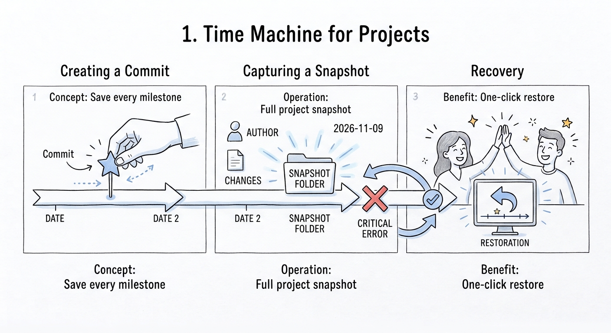
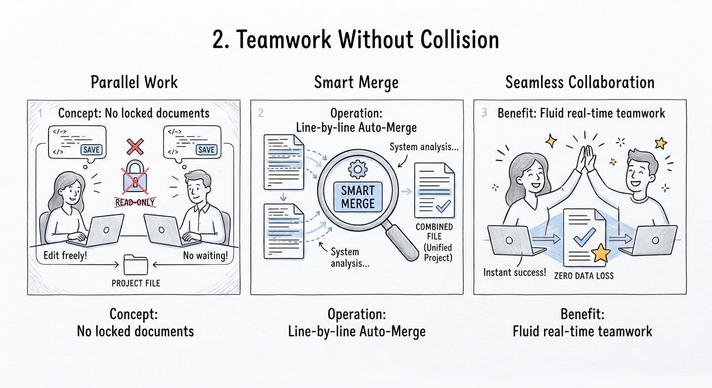
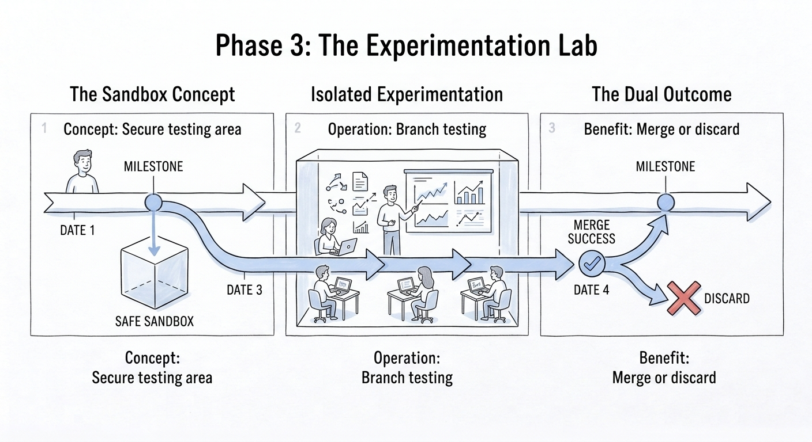
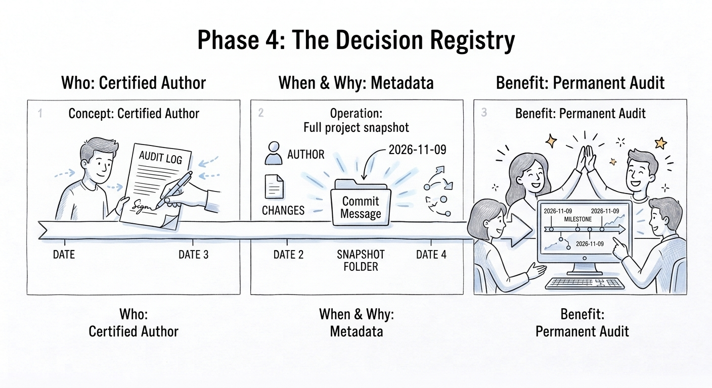

# Comprendre le Contrôle de Version (VCS) en 4 Piliers

> **Guide d'acculturation et de vulgarisation pour non-développeurs**  
> *Pourquoi et comment le contrôle de version transforme la collaboration et la gestion des données.*

---

Que raconte wikipedia à ce sujet : 
> Un système de gestion de versions (souvent appelé VCS pour Version Control System, ou gestion de source) est un outil logiciel qui permet de suivre, d'enregistrer et de gérer les modifications apportées à des fichiers (principalement du code source) au fil du temps.

## 1. La Machine à Voyager dans le Temps
### *L'Historique et les Points de Sauvegarde*

* **Le concept :** Chaque fois que vous terminez une étape clé ou validez une hypothèse, vous l'enregistrez (on appelle ça un **`Commit`**).
* **Le fonctionnement :** Le système prend une **photo instantanée** (*snapshot*) du projet à cet instant précis.
* **Le bénéfice :** Si vous faites une erreur critique le lendemain, vous n'avez rien perdu. Vous pouvez restaurer le projet exactement comme il était hier, en un clic, sans écraser le passé.

---

## 2. Le Travail d'Équipe sans Collision
### *La Fusion et le Travail Asynchrone*

* **Le concept :** Finis les documents verrouillés en *"Lecture seule"* parce qu'un collègue l'a laissé ouvert.
* **Le fonctionnement :** Plusieurs personnes peuvent travailler **simultanément** sur les mêmes documents. Le système analyse les écarts ligne par ligne et est capable de **fusionner (*Merge*)** les modifications de chacun automatiquement.
* **Le bénéfice :** Une collaboration fluide en temps réel sans risque d'écraser le travail de l'autre.

---

## 3. Le Laboratoire d'Expérimentation
### *Les Branches et les Univers Parallèles*

* **Le concept :** Un bac à sable sécurisé pour tester une idée risquée ou étudier une variante sans impacter le projet officiel.
* **Le fonctionnement :** Vous créez une **branche (*Branch*)**, c'est-à-dire une copie virtuelle et isolée du projet. Vous menez vos calculs et tests dans votre coin.
* **Le bénéfice :** 
  * **Si l'idée est concluante :** Vous l'intégrez dans le projet principal.
  * **Si l'idée échoue :** Vous supprimez la branche en un clic. Le projet de référence reste 100 % intact.
 

---

## 4. Le Registre des Décisions
### *La Traçabilité et l'Audit Permanent*

* **Le concept :** Une boîte noire infalsifiable de toutes les évolutions du projet.
* **Le fonctionnement :** À chaque enregistrement, le système consigne automatiquement :
  * **Qui** a modifié le document (auteur certifié).
  * **Quand** la modification a eu lieu (date et heure précises).
  * **Pourquoi** elle a été faite (grâce à un message explicatif obligatoire).
* **Le bénéfice :** Comprendre l'historique et les arbitrages techniques d'un projet des mois ou des années plus tard, sans dépendre de la mémoire des équipes.

---

## Tableau Récapitulatif

| Pilier | Métaphore | Terme Technique | Bénéfice Clé |
| :--- | :--- | :--- | :--- |
| **1. Historique** | La Machine à remonter le temps | `Commit` / Snapshot | Droit à l'erreur et sécurité absolue |
| **2. Fusion** | Le Travail d'équipe synchronisé | `Merge` / Pull Request | Zéro collision, travail simultané |
| **3. Branches** | Le Laboratoire d'expérimentation | `Branch` | Essayer des variantes sans risque |
| **4. Traçabilité** | Le Journal de bord certifié | `Log` / Blame | Audit permanent (qui, quand, pourquoi) |
